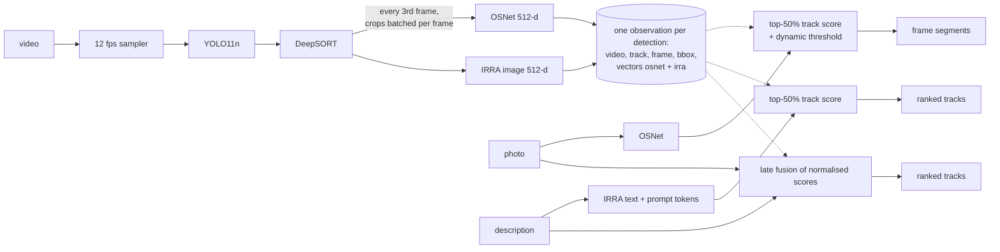

# Person Search

Find a person in indexed video **by photo** (OSNet, from the ICCVBIC 2026 paper),
**by description** (IRRA, model 2) or **by both**. This repo turns the team's
final-year system into a production service: index once, search many.

<!-- After pushing to GitHub, replace OWNER/REPO: -->
<!-- [](https://github.com/OWNER/REPO/actions/workflows/ci.yml) -->

> **Status: pre-Day-1 setup and Week 1 extraction done.** Both legacy repos are
> audited ([AUDIT.md](AUDIT.md)); detection, tracking, OSNet, IRRA, scoring and
> evaluation are extracted into modules with parity tests against the legacy
> code and a golden test that reproduces repo 2's selected frames on all 4 test
> cases. Indexing (Qdrant), the API, ONNX/INT8 and deployment follow the 30-day plan.

## How it works



Photo results are accepted automatically (the paper's rule); text and hybrid
results are ranked for a person to review.

## Repository layout

```
src/person_search/
  config.py          typed settings (pydantic-settings): env > .env > YAML profile > defaults
  interfaces.py      Detector / Tracker / ImageEncoder / TextEncoder protocols
  factory.py         settings -> concrete components (the only place that knows them)
  pipeline.py        run(video, photo) / run_text(video, text): the legacy flow, rebuilt
  types.py errors.py timing.py logging_utils.py render.py cli.py
  ingest/            video.py (sampler) detector.py (YOLO11n) tracker.py (DeepSORT) pipeline.py
  models/            osnet.py (vendored, MIT) osnet_encoder.py irra_encoder.py checkpoint.py preprocessing.py
  core/              scoring.py (paper's scoring + threshold) fusion.py (late fusion, legacy sum)
  search/            photo.py text.py hybrid.py results.py
  eval/              frame_metrics.py (P/R/F1) reid.py (mAP/CMC) golden.py
  index/ api/        Day 10 / Day 17 (planned contents in their __init__)
configs/             report_run.yaml (default = repo 2's final code) paper.yaml (values from the paper text)
tests/unit/          87 tests, no weights needed (CI)
tests/parity/        new modules vs legacy code (make parity)
tests/golden/        pipeline.run vs repo 2 on the 4 test cases (make golden)
tools/legacy/        Day 2 harness, golden builder, drawn-box extractor (import legacy by path)
tools/analysis/      scoring sweeps over cached ingests
docs/decisions/      one note per decision
```

## Quick start

```bash
# 1. environment (Python 3.10, CPU PyTorch)
uv sync --group dev            # or: make setup
# 2. legacy repos for parity/golden tests, outside this repo (never edit them)
make legacy                    # -> ../legacy/{person-reid-clip,amrit-pbvs}
# 3. weights -> models/ (team Drive + Hugging Face), prints SHA-256s
make weights
# 4. tests
make test                      # unit, ~30 s
make parity                    # OSNet + IRRA vs legacy, ~4 min
make golden                    # 4 test cases vs repo 2, ~10-20 min on CPU
```

```bash
export PS_CONFIG_FILE=configs/report_run.yaml
person-search photo  --video ../legacy/amrit-pbvs/test_case_004/test_video.mp4 \
                     --photo ../legacy/amrit-pbvs/test_case_004/query.jpg --out outputs/tc4 --render
person-search text   --video ../legacy/amrit-pbvs/test_case_001/test_video.mp4 \
                     --query "a man in a black jacket and blue jeans"
person-search ingest --video ../legacy/amrit-pbvs/test_case_002/test_video.mp4 --out outputs/tc2.npz
person-search eval-frames --cases-dir tests/golden/data/labels      # the report's 89.05% F1
person-search config                                                # resolved settings
```

Every setting can be overridden with `PS_<SECTION>__<FIELD>`, e.g.
`PS_SCORING__BASE_THRESHOLD=0.7`. See `.env.example`.

### Troubleshooting

- **`ModuleNotFoundError: No module named 'person_search'` on macOS.** The
  `.pth` files in `.venv` got macOS's `hidden` flag, and Python skips hidden
  `.pth` files. Check with `ls -lO .venv/lib/python3.10/site-packages | grep pth`;
  fix with `make fix-pth` (`make setup` runs it). The flag can come back, so
  every `make` target imports from `src/` directly and is not affected; only
  `uv run person-search ...` typed by hand needs `make fix-pth` again.
- **`make golden` fails on a Mac with missing/extra frames.** Expected before a
  Mac baseline exists: the shipped golden data are for linux-x86_64. Run
  `make golden-baseline` once, then `make golden`.
- **`(base)` in the prompt.** Run `conda deactivate`; uv manages its own Python 3.10.
- **Google Drive refuses the download** in `make weights`. Download the folder
  linked in repo 2's README by hand and place the files in `models/` under the
  names in `models/README.md`.

## Results so far

### Parity with the legacy code (`make parity`)

| Module | Compared with | Result |
|---|---|---|
| `OSNetEncoder` (campus v1, Market v0) | repo 2 `FeatureExtractor` | min cosine 0.99999994 on 20 crops; same rankings |
| `IRRAEncoder` image | repo 1 `extract_image_embedding_for_text_query` | min cosine 0.99999988 |
| `IRRAEncoder` text (with prompt tokens) | repo 1 `extract_text_embedding` | min cosine 1.00000000 on 5 descriptions; same top-10 |

### Golden test (`make golden`)

`pipeline.run(video, photo)`, rebuilt from the new modules, selects **exactly the
same frames on the same track IDs** as repo 2's untouched `run_reid` on all 4
test cases (missing 0, extra 0), on Linux x86_64.

Golden data are per platform, because decoding and float arithmetic differ
slightly between machines and the paper's hard thresholds amplify that
(AUDIT.md F18). On a new machine type, record its baseline once:

```bash
make fingerprint        # where does this machine first differ from linux-x86_64?
make golden-baseline    # run repo 2 untouched here, save tests/golden/data/<platform>/
make golden             # pipeline.run must match it exactly
```

### Day 2 numbers (photo query, frame-level, labels' TP + FN as ground truth)

| Run | System F1 | Precision | Recall | Hit rate |
|---|---:|---:|---:|---:|
| Report (counts in the committed `evaluation.json`) | 89.05% | 93.55% | 84.96% | 4/4 |
| Committed `output_annotated.mp4` files, re-scored | 83.92% | 94.27% | 75.61% | 4/4 |
| **Repo 2 re-run = this repo's default (golden baseline)** | **84.70%** | 85.48% | 83.93% | 4/4 |
| Same, tau_base 0.7 (the report's stated value) | 85.32% | 94.86% | 77.51% | 3/4 |

- The 89.05% cannot be reproduced from what is in the repos: the labels were
  made on a run whose output is not committed, and the four committed videos
  were themselves made with at least three different settings.
- Case 4 is only found with tau_base 0.65; at 0.7 it is "no match". Ask Amrit
  how 0.65 was chosen before an interviewer does (AUDIT.md section 5).
- Quote 94.23% (paper) and 89.05% (report) as the research results. Compare
  every new run against **84.70%**.

Speed (2 vCPU container, other jobs running - indicative only):

| Measurement | Value |
|---|---|
| One text query, repo 1 untouched, case 1 (575 frames) | 408 s (16 s model loading) |
| One photo query, repo 2 untouched, cases 1-4 | 194 s / 414 s / 448 s / 121 s |
| Ingest, this repo, case 4, OSNet + IRRA, batched | 207 s = 1.7 frames/s; IRRA 47%, OSNet 23%, DeepSORT 16%, YOLO 13% |

Indexed search (Day 11) replaces every per-query number above with a
vector lookup.

Details, the config table and all findings: [AUDIT.md](AUDIT.md).

### Where this leaves the 30-day plan

| Roadmap item | State |
|---|---|
| Before Day 1: weights, clone both repos | done (`make legacy`, `make weights`; Drive + HF both reachable) |
| Before Day 1: Amrit's campus test split, IRRA friend's latest code + college split, team OK to republish | **still yours** - only people can do these |
| Day 1: env, AUDIT.md | done |
| Day 2: reproduce repo 2, compare with labels, keep crops/track IDs, time a repo 1 text query | done (`tools/legacy/reproduce_repo2.py`, `time_repo1_text.py`); crops and track IDs are in `../legacy/runs/` on the machine that ran it, re-create with `make reproduce` |
| Day 3: src layout, pyproject groups, ruff, pre-commit, CI, config.py | done (push to GitHub and add the badge) |
| Day 4-5: Detector/Tracker/Encoder interfaces, OSNet + IRRA with loud failures and parity tests | done |
| Day 6: scoring unit tests, `pipeline.run`, `make golden` | done |
| Day 7 | free: write the Week 1 README section and decision notes in your own words |
| Day 8+ | MLflow registry, gate set, text test set, Qdrant, ... as planned. `eval/reid.py`, `search/text.py`, `search/hybrid.py`, `core/fusion.py` and `IngestResult.save/load` are already there to build on |

## Credits

The research system is the team's final-year project and paper:

> A. Kandel, P. Timalsina, P. Pandey, R. S. Saud, R. Shakya, "End-to-End Person
> Video Retrieval Using Track-Level Robust Scoring and Dynamic Thresholding,"
> *7th Int. Conf. on Computational Vision and Bio Inspired Computing (ICCVBIC)*,
> 2026, pp. 54-60.

- Repo 2 (YOLO + DeepSORT + OSNet pipeline, campus dataset, OSNet fine-tuning,
  evaluation data): Amrit Kandel and team.
- Repo 1 (model 2: CLIP-ReID and IRRA, prompt learning, IRRA weights on
  Hugging Face): `meteroid27` / `prasish17` and team.
- This production version: Roshan S. Saud.

Third-party code and licenses (YOLO11 AGPL-3.0, DeepSORT GPL-3.0, torchreid
MIT, CLIP MIT) are listed in [THIRD_PARTY_NOTICES.md](THIRD_PARTY_NOTICES.md).
The campus and college datasets are private and are not in this repository;
demo footage needs the participants' consent (see the roadmap's privacy notes).
